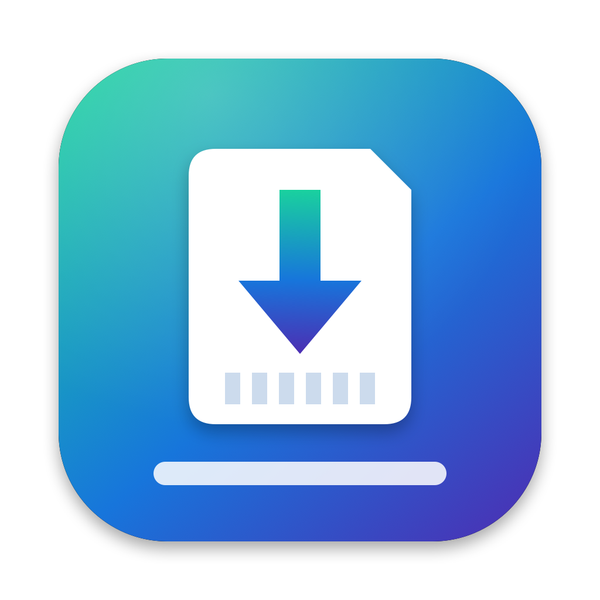

<p align="center"></p>

<h1 align="center">JadyxDrop</h1>

<p align="center">Drag-and-drop Switch games from your Mac to <a href="https://github.com/JulianDr14/Jadyx">Jadyx</a> on an Xbox in Developer Mode.</p>

---

JadyxDrop is a small native macOS app that talks to **Jadyx Portal**, the network uploader built into the Jadyx emulator. Drop `.nsp` or `.xci` files on its window and it sends them to your console, where Jadyx checks each game and adds it to its library.

## Features

- **Drag and drop:** drop games on the window or the Dock icon, or use *Open With → JadyxDrop*. Files are sent one after another.
- **XCI to NSP conversion:** Jadyx Portal only accepts `.nsp` base games, so `.xci` files are repacked into `.nsp` on your Mac first. Nothing is decrypted and no keys are needed: the game's NCAs are copied byte for byte. You can keep the converted `.nsp` next to the original or let the app delete it after installing.
- **Resumable uploads:** if Wi-Fi drops or the pairing code expires, pair again and the upload continues from the last confirmed block.
- **Progress:** each file shows its progress, transfer speed and time left, plus the console's status while it validates and publishes the game.
- **Leftover uploads:** if a half-finished upload is pending on the console, the app shows it and lets you discard it.
- **Universal app:** runs natively on Apple silicon and Intel Macs, on macOS 14 or later.

## Requirements

- An Xbox Series X|S or Xbox One in **Developer Mode** with [Jadyx](https://github.com/JulianDr14/Jadyx) installed, set up with your own keys and firmware.
- Your Mac and Xbox on the same local network.

## Usage

1. On the Xbox, open Jadyx and go to **Settings → File manager → Network connection → Start server**.
2. In JadyxDrop, enter the Xbox's IP address. Port `8080` is added automatically.
3. Type the 4-digit code shown in Jadyx. JadyxDrop connects as soon as you enter the fourth digit.
4. Pick **Internal storage** or **Dev storage (D:)**, then drop your games.

The first time it connects, macOS asks whether JadyxDrop can find devices on your local network. Choose **Allow**. If you denied it, turn it back on in **System Settings → Privacy & Security → Local Network**.

> Jadyx Portal accepts **base games** only. Install updates and DLC from the game's page in Jadyx itself.

## Install

Download the latest `.dmg` or `.zip` from Releases and drag **JadyxDrop** to Applications.

The app is not notarized, so the first time you open it, right-click it and choose **Open**, or allow it in **System Settings → Privacy & Security**.

## Build from source

Requires Xcode 16 or later, or just the Command Line Tools with Swift 6.

```sh
make build     # build/JadyxDrop.app (universal, ad-hoc signed)
make run       # build and launch
make package   # dist/JadyxDrop-<version>.zip, .dmg and SHA256SUMS.txt
make icon      # regenerate Resources/AppIcon.icns from scripts/make-icon.swift
```

To sign with a Developer ID, set `SIGN_IDENTITY="Developer ID Application: …"` before running `make package`.

The version number lives in `VERSION`.

## How it works

Jadyx Portal is a small HTTP server inside Jadyx. JadyxDrop speaks the same protocol as the portal's own web page:

| Step | What the app does |
|---|---|
| Pairing | `POST /api/v1/pair` with the 4-digit code returns a bearer session. |
| Uploads | Resumable, TUS-style: `POST /api/v1/uploads` to create an upload, then `HEAD` and 16 MiB `PATCH` chunks to send it, then `/finish` when it's complete. |
| Validation | The app polls `GET /api/v1/status` while the console validates the game and adds it to the library. |

XCI conversion reads the cartridge image's `secure` HFS0 partition and writes its files into a PFS0 container, which is the `.nsp` format.

## Legal

JadyxDrop is an unofficial tool. It is not affiliated with Jadyx, Microsoft or Nintendo. It does not contain or download keys, firmware or games. Only use games you have dumped yourself from hardware and cartridges or eShop purchases you own.

## License

[MIT](LICENSE) © 2026 xorica27
